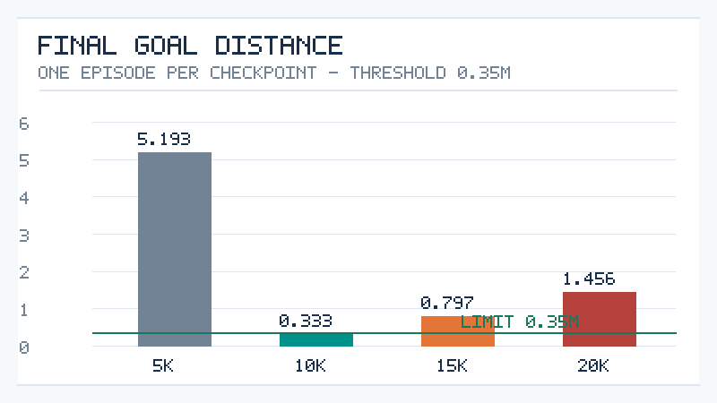
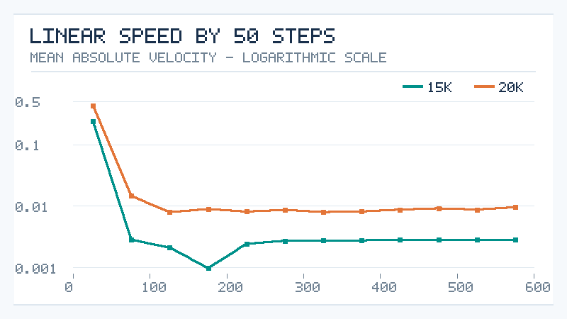
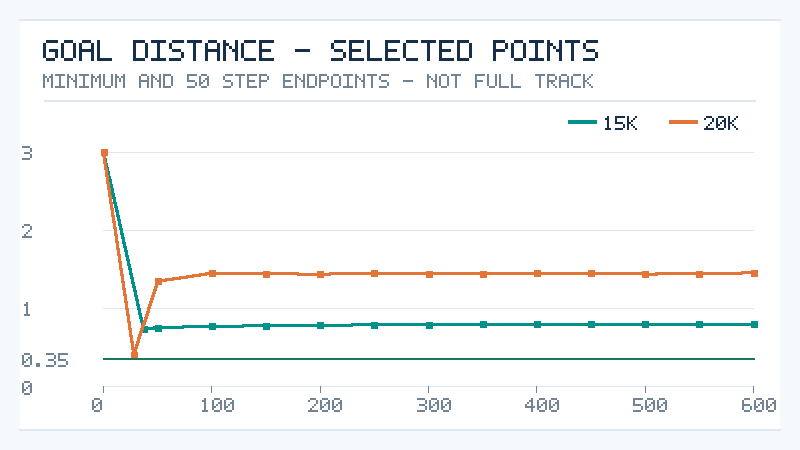

# SAC 长训练续篇：15,000／20,000 步策略退化与近零速度行为

**日期：**2026 年 10 月 17 日（JST）  
**性质：**实验进行期间的阶段性研究分析，非三小时结束报告  
**所属分支：**`feature/long-train-offline-20261016`  
**前期记录：**[11,000 步训练进展及 5k/10k 评估](sac-longrun-interim-11000.md)

> **证据范围。**以下数据来自用户提供的 WSL 终端输出、评估 JSON 摘要、分段轨迹统计与 SHA256 核验结果。完整 `episode-01.jsonl`、所有 Checkpoint 和本地候选标记文件仍保存在用户电脑中，**本次 GitHub 修改并未上传这些原始文件**。本文件中的 CSV 和图表是根据已观察统计生成的二次数据，不构成对全量原始轨迹的独立重算。

## 一、主要发现

在相同的室内固定目标场景中，**10,000 步模型成功到达前方 3 米目标，但 15,000 和 20,000 步模型均运行至 120 秒超时**。后两者并非完全恢复到早期无效漫游的状态：它们在起始阶段都能快速接近目标，但后半段出现严重的低速运动和长时间无法继续缩短目标距离。

具体而言：

- **15,000 步：**第 37 步距离目标最近，约 **0.731840 米**；之后长期接近静止，最终距离约 **0.797469 米**。
- **20,000 步：**第 28 步已经接近到 **0.406332 米**，距离 0.35 米成功阈值仅 **0.056332 米（约 5.63 厘米）**；此后反而远离目标，最终距离约 **1.455757 米**。
- 因而两者的共同点是未能完成末端接近，**但并不能视作完全相同的停滞模式**。为什么 20k 策略曾迅速接近却随后偏离，尚待完整轨迹和源码检查。

[单独查看 PNG](figures/sac-final-distance.png) · [保留的 SVG 矢量原图](figures/sac-final-distance.svg)

## 二、四次独立冻结策略评估的对比

| Checkpoint | 结果 | 环境步数 | 仿真时间 | 路径长度 | 最近目标距离 | 最终目标距离 | 累计奖励 |
| ---: | :--- | ---: | ---: | ---: | ---: | ---: | ---: |
| 5,000 | 超时 | 600 | 120 秒 | 20.858 米 | 2.186830 米 | 5.193285 米 | -10.388094 |
| **10,000** | **成功** | **47** | **9.4 秒** | **2.694 米** | **0.333471 米** | **0.333471 米** | **+14.861014** |
| 15,000 | 超时 | 600 | 120 秒 | 2.648 米 | 0.731840 米 | 0.797469 米 | -1.625 |
| 20,000 | 超时 | 600 | 120 秒 | 5.272 米 | 0.406332 米 | 1.455757 米 | -2.972982 |

**实验条件一致：**固定 `indoor_fixed` 场景、相同初始状态、前方 3 米目标、种子 7、确定性策略；每个 Checkpoint 仅 1 次 Episode。0/1 或 1/1 只是本次观察的结果，不是模型在一般场景中的成功概率估计。

5,000 步基线发生于梯度更新开始前。之后的单场景表现呈现**非单调变化**：成功后继续训练，结果可以再次失败。不能据此直接推断 SAC 算法整体不稳定、泛化失败或 Critic 发生了何种具体错误。

20,000 步评估于 2026-10-17 08:33:55 UTC 结束，当时管理器记录 20,000 有效步，随后启动 Chunk 22。由既有训练块报告统计，完成 20,000 步时累计记录了 **15,000 次 SAC 梯度更新**。这些并不是最终三小时训练总量。

## 三、15k 与 20k 的分段运动结构

将每个失败 Episode 的 600 个有效 `step` 按每 50 步分组，计算真实记录的命令线速度 `ack.v`、角速度 `ack.w`、距离和奖励。为分析方便，定义：

\[
\text{近零线速度}\quad\Longleftrightarrow\quad |\texttt{ack.v}| < 0.01\;\mathrm{m/s}.
\]

**注意：**这只是本次统计阈值，不等同于训练环境中的 `stalled` 判断。

| 轨迹 | 前 50 步平均绝对线速度 | 前 50 步结束时距离 | 第 51–100 步平均绝对线速度 | 第 51–100 步近零比例 | 最后 100 步平均绝对线速度 | 最后 100 步近零比例 |
| :--- | ---: | ---: | ---: | ---: | ---: | ---: |
| 15k | 0.24016 m/s | 0.7549 米 | 0.00286 m/s | **100%** | 0.00286 m/s | **100%** |
| 20k | 0.43620 m/s | 1.3462 米 | 0.01467 m/s | 56% | 0.00925 m/s | 52% |

[单独查看 PNG](figures/sac-speed-by-interval.png) · [SVG 矢量原图](figures/sac-speed-by-interval.svg)

### 3.1 15,000 步：快速接近后几乎完全静止

首 50 步从约 3 米缩短到 0.7549 米，期间第 37 步达到最小距离 0.731840 米。此后第 51–600 步的 **11 个分段，近零线速度比例均为 100%**，平均绝对线速度多数在 0.001–0.003 米/秒之间。目标距离缓慢从 0.756 米漂移至约 0.797 米，后期每步平均奖励接近 -0.01。

这表明策略在距离目标约 0.8 米处维持了长时间的近零速度控制。轨迹末尾虽然显示 `stalled=false`，但尚不能在未阅读判定函数的情况下据此宣布停滞检测存在程序错误。

### 3.2 20,000 步：接近成功阈值后再次偏离

20k 策略在第 **28 步** 已到达距离 **0.406332 米**，随后在第 50 步结束时却距离目标 **1.3462 米**。第 51–600 步的分段平均绝对线速度约为 0.008–0.015 米/秒，近零比例约为 **48%–62%**；后期距离主要波动在 1.44–1.46 米。

因而与 15k 不同，**不能说 20k 的所有后期动作都为零速度**，只能说它发生了长期低速、间歇接近零速度且未能有效接近目标的行为。车辆为何在第 28 步之后反而离目标更远，需要结合真实 XY 位姿、航向、动作映射和奖励分解确认。

[单独查看 PNG](figures/sac-goal-distance-selected.png) · [SVG 矢量原图](figures/sac-goal-distance-selected.svg)

**重要的绘图限制：**距离曲线只连接“初始距离、原始记录中已报告的最小值，以及每 50 步区间末端距离”；这些连线仅辅助辨认趋势，**不能当作完整逐步轨迹**。未来必须用本地原始 JSONL 重画真实轨迹，才能诊断转向、往复移动和局部旋转。

两张数据汇总表：

- [完整 50 步分段统计 CSV](data/sac-failure-50step-15000-20000.csv)
- [四次评估总表 CSV](data/sac-evaluations-5000-20000.csv)

## 四、10,000 步候选最佳模型：SHA256 身份确认

本地记录文件：`research/candidate-best-10000.json`。它已由用户在 WSL 内实际写入，但**本次仓库提交未上传该本地原文件**；仓库同时提供根据终端核对结果整理的[哈希与候选身份记录](data/candidate-best-10000-provenance.json)。

发现两个名称都含有 10,000 步的目录：

| Checkpoint 目录 | 与成功评估的模型哈希匹配 | 经验池哈希匹配 | Manifest 哈希匹配 |
| :--- | :---: | :---: | :---: |
| **`step-10000-1c2ad374`** | **是** | **是** | **是** |
| `step-10000-bc2de5b9` | 否 | 是 | 否 |

因此，10,000 步成功评估所对应的**唯一经完整哈希匹配的目录**是：

`checkpoints/step-10000-1c2ad374`

其 `model.zip` SHA256 为：

`26ea4c6455a9f85ea9aeb1a3c473351115b91b04fa733fd7e731e7c9d13dd3b7`

另一个目录的 Replay Buffer 哈希相同，但模型与 Manifest 哈希不同。它们为什么在相同步数下产生不同模型，**尚未查明**；必须同时保留，不能随意删除或覆盖。候选标记也不会改动 `checkpoints/latest.txt`。

**“当前候选最佳”仅指上述一次固定场景评估，不代表总体最优策略。**

## 五、研究结论的证据层级与后续工作

### 已有观测直接支持

1. 10k 在固定目标任务中成功，而 15k 和 20k 均超时；增加训练步数并不保证本场景评价指标单调改善。
2. 15k 在约第 50 步之后长时间输出近零线速度指令。
3. 20k 曾经靠近到距离成功阈值仅约 5.63 厘米，之后距离回升，后期表现为低速而非全部零速。
4. 通过三个文件的 SHA256，已唯一确定 10k 成功评估对应的 Checkpoint。

### 尚未证实的解释

- 动作第 1 维约为 -0.5 时对应 `ack.v` 接近零，可能反映动作至速度的偏移映射；**未核实映射函数之前，不能推导它的精确表达式**。
- 可能存在奖励函数、Critic 估值、熵调节、动作限幅、目标附近朝向控制等问题，但现有统计无法区分机制。
- `stalled=false` 与研究定义的近零速度并不矛盾，必须先审计停滞判定条件。

### 三小时训练结束后的优先事项

1. 冻结代码版本，读取动作映射、奖励、终止、停滞判定的精确实现，检查是不是存在不利于末端接近的平衡动作。
2. 利用原始 JSONL 重画各 Checkpoint 的完整轨迹（XY、目标距离、朝向、线速度、角速度和奖励分解），不要仅依靠 50 步统计。
3. 使用多个随机种子、不同起点、不同目标方向和地图对所有候选模型重新评估，并加入接触/碰撞真值指标。
4. 将未知地图探索度和覆盖率设为独立的下一阶段目标；不要把 3 米定点导航成功等同于 SLAM 自主探索成功。
5. 完整保存运行日志、模型、Replay Buffer、原始评估、配置及校验值；保留“本场景候选最佳”与“最新 Checkpoint”两个不同角色。

## 六、数据、作图方法与图片兼容性说明

- 运行目录：`/home/user111/AI-Training/runs/sac-longrun-20261017`。
- 输入数据：用户提供的 `evaluations/*/evaluation.json`、`episode-01.jsonl` 分段统计与 SHA256 输出。
- 图 1–3 **完全由数值、图形绘制代码生成，没有使用 AI 绘图**。
- 报告现在**以 PNG 嵌入**，提高 GitHub Markdown 和其他查看器的兼容性；原 SVG 文件保留，作为矢量备份。图中文字采用简洁英文字母与国际单位符号，以避免跨系统中文字体缺失，正文和图注均为中文。
- [Matplotlib 绘图脚本](scripts/plot_sac_diagnostics.py)可从已提交的 CSV 再生成相同数据含义的 SVG/PNG（图形样式可能不同），输出到 `figures/generated/`。
- 最后一次有证据的状态为训练累计 **20,000 步、15,000 次梯度更新，Chunk 22 已启动**。本报告**不代表最终结束状态**。
